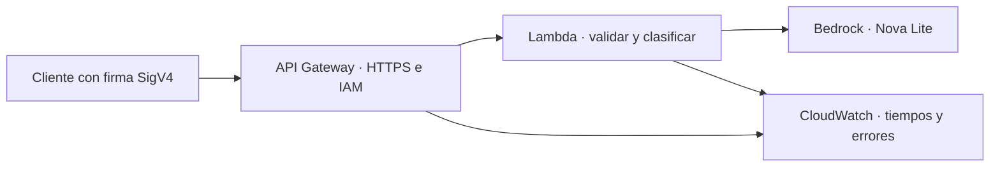

# S17 · Clasificar una incidencia con Lambda, API Gateway y Bedrock

La misma tarea de S16: enviamos una incidencia ficticia y recibimos **categoría,
prioridad y respuesta**. Ahora una función Lambda llama a Amazon Bedrock.
El modelo de esta demo es **Nova Lite (`amazon.nova-lite-v1:0`) dentro de
`eu-north-1` (Estocolmo)**. No utiliza OpenRouter ni su API key.

**Estado del ensayo (11/11/2026):** despliegue, IAM, salud, validación y limpieza
comprobados en AWS. La clasificación real y el lote de mediciones siguen
pendientes: el proyecto del profesor tiene cuota cero de Bedrock. El preflight
detecta ese bloqueo antes de desplegar. [Detalle del ensayo](ENSAYO.md).



## Qué hace cada servicio

| Servicio | Para qué lo usamos |
|---|---|
| API Gateway HTTP API | Publica HTTPS, comprueba IAM y entrega el evento a Lambda. |
| Lambda | Ejecuta nuestro Python cuando llega una petición. |
| Bedrock | Ejecuta el modelo gestionado; pagamos por tokens. |
| IAM | Autoriza las tres conexiones: cliente → API, API → Lambda y Lambda → modelo. |
| CloudWatch Logs | Guarda registros de API y función durante tres días. |
| CloudFormation | Crea y elimina este conjunto de recursos a partir de una plantilla. |

No necesitamos configurar una VPC, IP pública, security group, ECR, Secrets Manager
ni un bucket S3. Lambda utiliza su red gestionada predeterminada. El código cabe
en una plantilla y CloudFormation lo empaqueta: no hay que construir Docker.

## Archivos que vamos a leer

- **`lambda_function.py`**: la aplicación, con comentarios en español.
- **`plantilla.json`**: recursos y permisos de AWS.
- `preparar.py`: introduce la aplicación en la plantilla de despliegue.
- `cliente.py`: firma las peticiones y recoge mediciones sin mostrar credenciales.
- `coste.py` y `tarifas.json`: estiman 1.000 peticiones sin ejecutarlas.

Para el directo: [guion corto](docs/guion-clase.md).
Para repetirlo con un agente: [prompt](docs/prompt-agente.md).
El [ejercicio](docs/ejercicio.md) explica qué debe hacer el alumno después.

## 1. Preparar el ordenador

Descarga el repositorio y entra en su carpeta (o descomprime el ZIP de clase):

```bash
git clone https://github.com/JoseAntonioNuevo/thepower-bedrock.git
cd thepower-bedrock
```

Necesitas **Python 3.12**, **AWS CLI v2** y un perfil AWS temporal con permisos
para el laboratorio. Los comandos siguientes se ejecutan desde esta carpeta.
No necesitas Docker.

En macOS o Linux:

```bash
python3 -m venv .venv
source .venv/bin/activate
python -m pip install -r requirements.txt
```

En Windows, desde PowerShell:

```powershell
py -3.12 -m venv .venv
.\.venv\Scripts\python.exe -m pip install -r requirements.txt
```

Para seguir los bloques Bash del resto de la guía, abre **Git Bash** en Windows
y activa el mismo entorno con `source .venv/Scripts/activate`.
Así usamos los mismos comandos en los tres sistemas. Las dependencias se
instalan para tu sistema y arquitectura: no copies una `.venv` entre ordenadores.

Alternativa si ya utilizas uv: `uv venv --python 3.12`, activa el entorno de
tu sistema y ejecuta `uv pip install -r requirements.txt`.

## 2. Elegir perfil, proyecto y nombres

Sustituye el perfil y los doce dígitos por los de **tu propio proyecto**.
El stack debe tener un nombre propio que empiece por `s17-`.

```bash
export AWS_PROFILE=tu-perfil
export AWS_REGION=eu-north-1
export S17_ACCOUNT=123456789012
export S17_STACK=s17-clasificador-tu-nombre
aws login --profile "$AWS_PROFILE" --region "$AWS_REGION"
aws sts get-caller-identity --profile "$AWS_PROFILE" --region "$AWS_REGION"
```

`aws login` abre la autorización en el navegador. Si tu organización utiliza
IAM Identity Center, renueva su perfil con `aws sso login --profile "$AWS_PROFILE"`.
Comprueba que `Account` coincide con `S17_ACCOUNT` antes de crear recursos.

| Variable | Dónde existe | Significado |
|---|---|---|
| `AWS_PROFILE` | Tu terminal | Perfil que contiene la sesión temporal. |
| `AWS_REGION` | Tu terminal y runtime Lambda | `eu-north-1`; esta demo rechaza otras regiones. |
| `S17_ACCOUNT` | Tu terminal | ID esperado del proyecto; el cliente comprueba STS. |
| `S17_STACK` | Tu terminal | Nombre propio del conjunto de recursos. |
| `BEDROCK_MODEL_ID` | Lambda, desde la plantilla | `amazon.nova-lite-v1:0`, sin perfil entre regiones. |
| `APP_VERSION` | Lambda, desde `preparar.py` | Hash del código para identificar lo desplegado. |

**No hay archivo `.env` ni API key de Bedrock.** AWS CLI usa tu sesión local;
Lambda obtiene credenciales temporales de su rol. No copies claves, session
tokens ni la clave OpenRouter de S16 a la función.

## 3. Comprobar acceso y cuotas antes de desplegar

```bash
python cliente.py preflight
```

Lee identidad, disponibilidad del modelo, cuotas de Bedrock y concurrencia de
Lambda; **no ejecuta una inferencia**. Debe terminar correctamente y las tres
cuotas de Nova Lite deben ser mayores que cero.

Si ves cuota cero o `No completado`, detente aquí y revisa **Service Quotas →
Amazon Bedrock → eu-north-1** y AWS Settings → Billing. Mantener el plan Free
no garantiza cuota de inferencia. Cambiar a pago tampoco se considera una
solución comprobada sin volver a leer las cuotas.

El 11/11/2026 el proyecto del profesor devuelve cuota cero para Nova Lite.
Falta solicitar a AWS la revisión de la cuota: [datos y texto para soporte](docs/cuotas-aws.md).
La disponibilidad `AUTHORIZED/AVAILABLE` del catálogo por sí sola no acredita
una llamada real. No repitas solicitudes frente a este error.

## 4. Preparar y crear los recursos

```bash
python preparar.py
aws cloudformation deploy \
  --profile "$AWS_PROFILE" --region "$AWS_REGION" \
  --stack-name "$S17_STACK" \
  --template-file .demo-aws/plantilla.json \
  --capabilities CAPABILITY_IAM \
  --tags Project=thepower-s17 Purpose=classroom-demo
python cliente.py estado
```

`preparar.py` introduce el archivo de la aplicación en la plantilla local.
`deploy` crea los recursos y espera al resultado; en una repetición con el
mismo nombre actualiza ese stack. Revisa el nombre antes de ejecutarlo.
`CAPABILITY_IAM` reconoce que la plantilla crea **un rol para Lambda**:
no modifica tu rol de acceso personal.

Abre la consola en Estocolmo y localiza:

1. **CloudFormation → tu stack → Resources**: inventario del laboratorio.
2. **Lambda → tu función → Code**: el archivo aparece como `index.py`.
3. **Lambda → Configuration**: 512 MiB, 24 s, modelo y rol.
4. **API Gateway → tu HTTP API → Routes**: `GET /health` y `POST /clasificar`, ambas `AWS_IAM`.
5. **IAM → rol de la función**: `bedrock:InvokeModel` sobre un solo modelo de Estocolmo y escritura en su grupo de logs.

No se configura concurrencia provisionada ni reservada. En el proyecto del
profesor hay **diez ejecuciones simultáneas compartidas**; reservar dos exigiría
una cuota mayor. La API limita el ritmo a 1 solicitud/s y ráfaga 1 como medida
de mejor esfuerzo; esto **no equivale a un límite estricto de una ejecución**.
El cliente envía las peticiones secuencialmente. No hacemos pruebas de carga.

## 5. Medir seis clasificaciones

Para tener oportunidad de capturar frío, mide antes de llamar a `/health`
o calentar la función desde la consola.

```bash
python cliente.py medir --execute
python cliente.py logs
```

`medir` hace como máximo **seis clasificaciones reales**, secuenciales, con el
mismo texto ficticio; se detiene en el primer fallo y no lo reintenta.
`logs` relee CloudWatch sin volver a consumir el modelo. Si los registros
todavía no han llegado, vuelve a ejecutar únicamente `logs`.

Cada respuesta contiene los mismos campos de negocio que S16 y metadatos
añadidos por nuestra función. Este es **el formato ilustrativo**, no una medición:

```json
{
  "modo": "real",
  "modelo": "amazon.nova-lite-v1:0",
  "resultado": {
    "categoria": "acceso",
    "prioridad": "media",
    "respuesta": "Respuesta breve del modelo."
  },
  "metadata": {
    "request_id": "identificador-de-Lambda",
    "version": "hash-del-codigo",
    "entorno": "identificador-del-entorno",
    "first_in_environment": true,
    "duration_ms": 900,
    "model_duration_ms": 880,
    "consumo": {"inputTokens": 250, "outputTokens": 100, "totalTokens": 350}
  }
}
```

Categorías: `acceso`, `facturacion`, `tecnico`, `consulta`.
Prioridades: `alta`, `media`, `baja`. El texto admite 1–1.000 caracteres y la
respuesta 1–500. Pedimos un esquema mediante `toolConfig` y validamos los
campos otra vez en Python. La herramienta solo define la salida: no ejecuta
acciones ni provoca una segunda llamada al modelo.

| Medida | De dónde sale |
|---|---|
| Tiempo HTTP | Nuestro cliente: red, gateway, inicialización y función. |
| `duration_ms` | Tiempo dentro del handler; no incluye INIT previo. |
| `model_duration_ms` | Tiempo de la llamada al SDK, incluido un error. |
| Tokens | `usage` devuelto por Bedrock; si falta, queda `null`. |
| `Init Duration` y `Billed Duration` | REPORT de Lambda unido al mismo `request_id`. |

No sumes tiempos anidados. `first_in_environment` es una pista de proceso:
**el frío se acredita con Init Duration**, no por ser la primera fila.
Si no se captura, se declara `no_capturado`. Para contar una warm exigimos
entorno reutilizado y REPORT correspondiente. Si no hay cinco, la muestra
queda incompleta; no se rellena a base de repetir solicitudes.

Los recibos locales están en `.demo-aws/mediciones.json` y `logs.json`.
No subas esa carpeta al repositorio.

## 6. Probar salud, IAM y validación

```bash
python cliente.py probar --health --execute
python cliente.py probar --sin-firma --execute
python cliente.py probar --texto "" --execute
```

Resultados esperados: **200**, **403** y **422**. Ninguna de estas tres pruebas
invoca el modelo: salud no clasifica, IAM rechaza antes de Lambda y la entrada
vacía se rechaza antes del SDK. Los dos últimos comandos terminan con código
de salida 1 porque están comprobando un rechazo HTTP.

Para una clasificación adicional (consume una inferencia):

```bash
python cliente.py probar --texto "Me han cobrado dos veces una factura ficticia" --execute
```

Hay tres permisos diferentes: tu identidad necesita `execute-api:Invoke` sobre
la ruta; API Gateway necesita `lambda:InvokeFunction`; el rol de Lambda necesita
`bedrock:InvokeModel`. **Converse es el método del SDK, no una acción IAM
llamada `bedrock:Converse`.** Una firma correcta no concede permisos.
El administrador del laboratorio concede acceso al llamante si su perfil
todavía no lo tiene; la demo no cambia identidades humanas.

## 7. Calcular el coste de 1.000 solicitudes

```bash
python coste.py
```

No llama a AWS ni al modelo. Con los supuestos incluidos (512 MiB, 1.500 ms
warm, 1.800 ms cold, 5 % de frío, 250 tokens de entrada y 100 de salida), da
**0,05722 USD de coste parcial**. Incluye Lambda, HTTP API, tokens de Nova Lite
y 0,002 GB de logs durante tres días. Excluye tráfico, impuestos y descuentos.
Las tarifas públicas de Estocolmo se leyeron el 11/11/2026 y están en
`tarifas.json`; el resultado es una estimación, no una factura.

Con las seis clasificaciones y los REPORT completos:

```bash
python coste.py --mediciones .demo-aws/mediciones.json --fraccion-fria 0.05
```

Si no se capturó frío, usa `--fraccion-fria 0` para un escenario solo warm.
La frecuencia fría, los logs y el volumen mensual siguen siendo supuestos.
El programa rechaza muestras incompletas: no inventa tokens ni duraciones.
`Billed Duration` ya incluye INIT cuando se factura; no lo sumes otra vez.

## 8. Eliminar el laboratorio

Comprueba que `$S17_STACK` es exclusivamente tu demo, conserva los recibos que
necesites y ejecuta:

```bash
aws cloudformation delete-stack \
  --profile "$AWS_PROFILE" --region "$AWS_REGION" --stack-name "$S17_STACK"
aws cloudformation wait stack-delete-complete \
  --profile "$AWS_PROFILE" --region "$AWS_REGION" --stack-name "$S17_STACK"
aws cloudformation describe-stacks \
  --profile "$AWS_PROFILE" --region "$AWS_REGION" --stack-name "$S17_STACK"
```

La última lectura debe indicar que el stack no existe. Se retiran API,
integración, rutas, función, rol propio y ambos grupos de logs. En la consola
comprueba que la función y API del inventario ya no aparecen. No hay un modelo
propio de Bedrock que borrar. Los consumos anteriores pueden aparecer después.
Los recursos de S16 y el perfil de acceso se conservan.

## Errores y límites que conviene entender

| Respuesta | Capa y explicación |
|---|---|
| 403 | API Gateway: firma ausente/inválida o falta permiso sobre la ruta. |
| 422 | Lambda: entrada inválida; no se consume Bedrock. |
| 503 `bedrock_sin_cuota_o_limitado` | Bedrock limita la inferencia o la cuota es cero; no hay clasificación. |
| 502 `bedrock_denegado` | Rol del modelo, disponibilidad o políticas del proyecto. |
| 502 `respuesta_del_modelo_invalida` | El JSON del modelo no cumple el contrato. |
| 504 | Falta margen de tiempo o timeout; no significa que el gasto sea cero. |

El cliente espera 35 s; la integración 29 s; Lambda 24 s; el SDK conecta en
2 s y espera lectura hasta 15 s, con un intento total. Son límites elegidos
para la demo. HTTP API tiene un máximo de integración de 30 s; ampliar Lambda
no amplía ese gateway. Para trabajos largos conviene un patrón asíncrono.
Para streaming hace falta un transporte compatible; no está implementado aquí.

Azure Functions + Microsoft Foundry y Cloud Run functions + Vertex AI son
alternativas por función; sus APIs, modelos, cuotas y precios no son idénticos.
Para tráfico continuo o procesos largos también puede convenir Fargate,
como en S16. Al cambiar de OpenRouter/Luna a Nova Lite no estamos aislando
el efecto de la arquitectura sobre coste o latencia.

## Comprobar el código sin AWS

Estas pruebas no necesitan credenciales ni consumen modelos. Los dobles y el
Stubber comprueban contrato, errores sin reintentos, mediciones y coste; no
sustituyen una clasificación real en Bedrock.

```bash
python -m pip install -r requirements-dev.txt
python -m pytest -q
python -m ruff check .
python -m ruff format --check .
python preparar.py
cfn-lint .demo-aws/plantilla.json
```

## Fuentes técnicas

- [Converse y herramientas](https://docs.aws.amazon.com/bedrock/latest/userguide/tool-use.html).
- [IAM en HTTP API](https://docs.aws.amazon.com/apigateway/latest/developerguide/http-api-access-control-iam.html).
- [Límites de HTTP API](https://docs.aws.amazon.com/apigateway/latest/developerguide/http-api-quotas.html).
- [Concurrencia de Lambda](https://docs.aws.amazon.com/lambda/latest/dg/lambda-concurrency.html).
- [Nueva experiencia AWS y servicios admitidos](https://docs.aws.amazon.com/accounts/latest/reference/supported-services-sign-up-new.html).
